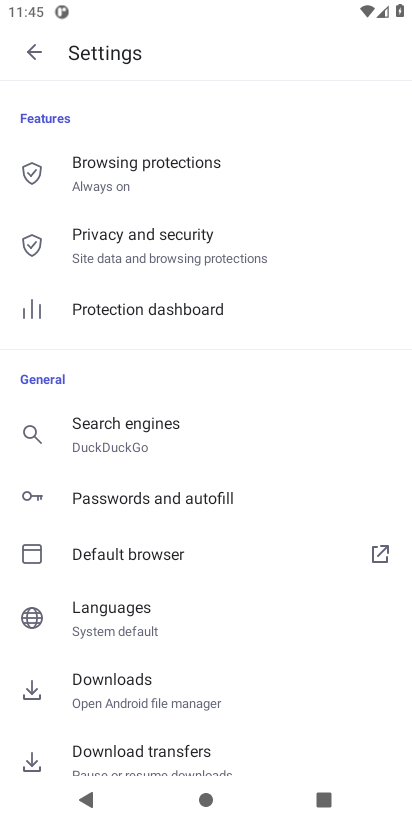

# Kosher Browsing

An independent Android browser built with Mozilla GeckoView and a packaged protection WebExtension. Current version: **2.10 (version code 17)**. Package: `org.shield.browser`. Developer: sdmde.

## Features

- Chrome-style native toolbar and tab grid, plus Brave-inspired settings with leading icons, purple accents, grouped sections and light/dark themes. The supplied blue logo is retained; this is not a repackaged Chrome app.
- Persistent Gecko profile for cookies and website sign-ins; saved tabs, browsing history, bookmarks, folders and bookmark import/export.
- Fixed DuckDuckGo address-bar search and mandatory Safe Search parameters on supported search routes.
- On-device image processing: configured skin-color pixels receive grayscale and strong blur with a 15-pixel surrounding mask. A 40×40 region becomes a 70×70 mask. Images stay hidden until verification succeeds; decoding, size, request and filtering failures stay blocked. Recognized CAPTCHA providers have scoped challenge exceptions.
- Unsupported image surfaces are hidden conservatively. This can hide website icons, charts and previews. Color detection is heuristic and is not a guarantee that every unsuitable image is identified.
- Bundled adult-domain/query restrictions, social-site blocks, advertising rules, YouTube Shorts blocking and expanded random stranger-chat restrictions. Listed hosts include subdomains; recognizable Omegle-style brand variants are checked across common domain suffixes. Lists are bundled snapshots, not an automatically updated category service. New names, proxies and custom rendering paths are not guaranteed covered.
- Downloads opens Android's file manager/Downloads view. **Download transfers** retains in-app pause/resume controls. Downloads pause when the browser is backgrounded; no foreground-service permissions are requested.
- APK installation packages are blocked by URL, name, MIME and completed-file checks. Downloads are staged in private cache before allowed files are exported. This is not a device-wide installation restriction or a universal classifier for encrypted/nested archives.
- Main interface languages: English, Hebrew, Arabic, Spanish and French; RTL for Hebrew/Arabic. Some technical text falls back to English. Ordered website-language preferences are separate from app language. Gecko translation controls depend on supported devices/language pairs and may download models from Mozilla.

## Build

Requires JDK 17+, Android SDK platform 37, build tools 36.0.0 and network access to Gradle/Maven dependencies. The wrapper uses Gradle 9.3.1 with Android Gradle Plugin 9.1.0; AGP prints an advisory because compileSdk 37 is newer than its tested range.

```sh
./gradlew assembleDebug lintRelease
```

On Windows, use `gradlew.bat`. Debug APKs are produced under `app/build/outputs/apk/debug/` for ARM64, ARMv7, x86_64 and universal installation. Debug keys differ from Google Play app-signing keys: update a Play installation through its Play testing/release track to preserve data.

For a signed Play bundle, supply your own keystore through the `KOSHER_UPLOAD_KEYSTORE`, `KOSHER_UPLOAD_STORE_PASSWORD`, `KOSHER_UPLOAD_KEY_PASSWORD` and optional `KOSHER_UPLOAD_KEY_ALIAS` environment variables, then run `./gradlew bundleRelease`. The repository contains no signing keys or passwords. `build-release.ps1` supports an external private signing directory. See [release guidance](PLAY-RELEASE.md).

## Tests

```sh
npm install --prefix tests
npm test --prefix tests
```

Set `CHROMIUM_PATH` when using an existing desktop Chromium browser. Tests use synthetic images and mocked requests; they do not prove live compatibility with every website. JVM download-policy tests are in `tests/downloads/DownloadPolicyTest.java`. They can be compiled with `app/src/main/java/org/shield/browser/DownloadPolicy.java` and run as `org.shield.browser.DownloadPolicyTest`.

Validation has included compilation, Android lint, desktop policy/image checks, JVM package checks, bundle/signature checks and native-library alignment checks. Android API 30 x86_64 emulator tests covered ordinary content, an educational article, known/variant chat hosts, redirects, dynamic unknown-site detection and private-tab blocking. No physical-device testing has been performed. Phone layout, file-manager integrations, CAPTCHA flows and translation-model behavior remain for device testing.

## Privacy and license

Browser data is primarily stored in the app's local profile. Websites, search engines and engine services still receive their ordinary network requests. See [privacy policy](PRIVACY-POLICY.md), [third-party notices](THIRD-PARTY.md) and [GPL-3.0 license](LICENSE).

Mandatory protections have no off switch. This app cannot prevent uninstalling it, using another browser or every possible bypass; it is not a device-owner parental-control system.

## Incognito and history

Use New incognito tab in the menu or the shield button in the tab tray. Private tabs use Gecko private mode and are excluded from session restoration, history and recently closed tabs. Popups and new linked tabs inherit private mode. Close all private tabs to end the private session. Private tabs are labeled and excluded from screenshots and previews. Downloads are disabled in incognito; deliberately saved bookmarks remain. Incognito does not hide activity from websites or your network provider. Private image verification omits cookies, so images requiring authentication can remain hidden. All browsing protections remain enabled.

History opens in a full-screen searchable two-column card grid. Tap a card to open it, or hold it to delete the entry or open it privately. Clear history removes all saved entries. Cards show site names rather than stored page screenshots.

## Stronger random-chat blocking in 2.9

The network rules cover 2.9 domain-list updates, recognizable random/anonymous/stranger-chat host variants, search intent, subframes and WebSocket requests. Newly covered services include TalkWithStranger, ChatMatch, Meetgle, Chatous, Chatib and Chatingly. An isolated content script also checks titles, descriptions and headings alongside chat-start controls to detect unfamiliar interactive chat sites, including dynamic pages. Detection stops the page and sends it to the built-in blocked screen.

Detected hosts are remembered only in extension memory until the browser process stops, separately for private and normal browsing. Later requests and WebSockets from those hosts are blocked. There is no external classification service or automatic list update. Content detection is heuristic: an undisclosed or deliberately disguised service can still evade it. Ordinary calling services and articles are not blocked merely for mentioning chat.

The list was checked against service-owned pages on 2026-10-23: [TalkWithStranger](https://randomchat.talkwithstranger.com/chatrooms/), [ChatMatch](https://www.chatmatch.app/), [Meetgle](https://meetgle.com/video-chat/), [Chatous](https://chatous.com/), [Chatib](https://www.chatib.us/) and [Chatingly](https://chatingly.com/).

## Version 2.10 settings

The settings interface adapts the supplied Brave APK with Features, General and Display groups. Existing search, language, appearance, privacy and download actions remain functional. Brave account, Wallet, Rewards, News and VPN services are not included.



[Download the latest release](https://github.com/sdmde/Kosher-Browsing/releases/tag/v2.10). The ARM64 test APK uses the existing test signing certificate; Google Play users should update through their Play track.
